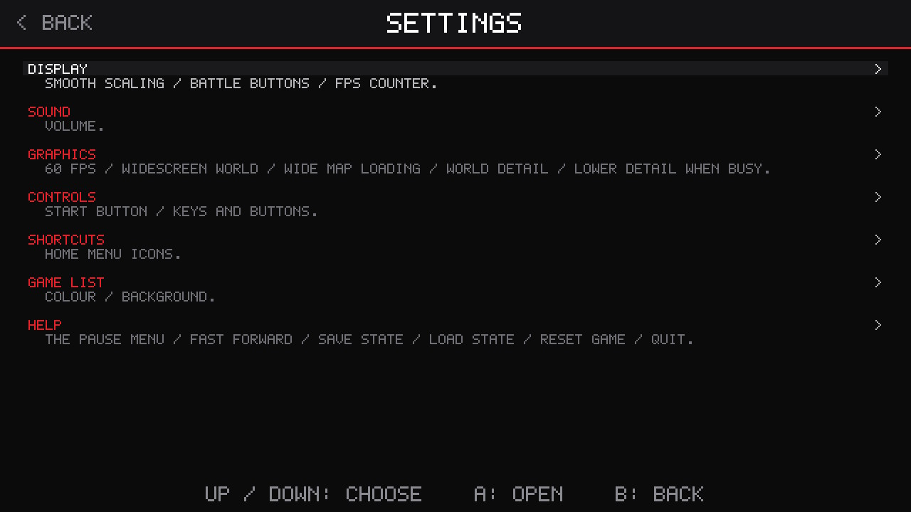
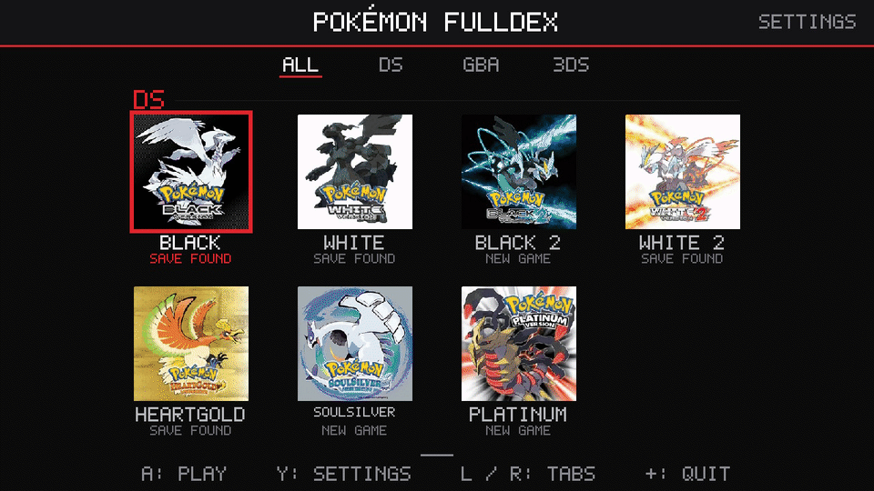

# Pokémon Fulldex

**Your favourite DS and GBA Pokémon games on a PC (Windows and Linux), a Mac, a Steam
Deck or other handheld PC, an Android phone, an iPhone or iPad, or a modded Nintendo Switch: one screen,
widescreen, 60 fps, up to 4K on a PC and 720p on the Switch.** No more squinting at two tiny stacked DS screens.


## Downloads

| Where you play | Download | Install |
|---|---|---|
| **Windows** PC, and Windows handhelds (ROG Ally, Legion Go, MSI Claw) | [pokemon-ds-wide-pc-windows-x86_64.zip](../../releases/download/pc-v1/pokemon-ds-wide-pc-windows-x86_64.zip) | [PC](#on-a-pc-mac-steam-deck-or-handheld-windows-macos-and-linux) |
| **Mac** with Apple silicon (M1 and newer) | [pokemon-ds-wide-pc-macos-arm64.zip](../../releases/download/pc-v1/pokemon-ds-wide-pc-macos-arm64.zip) | [Mac](#on-a-pc-mac-steam-deck-or-handheld-windows-macos-and-linux) |
| **Mac** with an Intel processor | [pokemon-ds-wide-pc-macos-x86_64.zip](../../releases/download/pc-v1/pokemon-ds-wide-pc-macos-x86_64.zip) | [Mac](#on-a-pc-mac-steam-deck-or-handheld-windows-macos-and-linux) |
| **Linux** and the **Steam Deck** | [pokemon-ds-wide-pc-linux-x86_64.tar.gz](../../releases/download/pc-v1/pokemon-ds-wide-pc-linux-x86_64.tar.gz), or as an [AppImage](../../releases/download/pc-v1/pokemon-ds-wide-pc-linux-x86_64.AppImage) (Gear Lever) | [PC](#on-a-pc-mac-steam-deck-or-handheld-windows-macos-and-linux) |
| **Android** phone (64-bit, Android 7 or newer) | [pokemon-ds-wide-android.apk](../../releases/download/android-v1/pokemon-ds-wide-android.apk) | [Android](#on-android) |
| **iPhone** and **iPad** (iOS 14 or newer, sideloaded) | [pokemon-ds-wide-ios.ipa](../../releases/download/ios-v1/pokemon-ds-wide-ios.ipa) | [iPhone](#on-an-iphone-or-ipad) |
| **Nintendo Switch** (homebrew) | [pokemon-ds-wide-all-switch.zip](../../releases/download/all-games-v2/pokemon-ds-wide-all-switch.zip) | [Switch](#on-the-nintendo-switch) |

**All seven DS games in every download:** Pokémon Black 2, White 2, Black, White, SoulSilver,
HeartGold and Platinum. **The GBA games too** on Windows, Linux, Android and the Switch:
Pokémon Emerald, FireRed, LeafGreen and Ultra Violet ([below](#the-gba-games)). Pokémon Omega
Ruby is in the works, as its own project: it is in the game list's 3DS tab, COMING SOON.
What's new in each: [Releases](../../releases).

One program per platform: start it and pick the game from the list. The
downloads are free of the games themselves: you bring your own ROMs, and the
program reads what it needs from them when the game starts.

## Use your own save

Carry on from your own save: from another emulator, a flash cart or your real
cartridge. Copy it in under the game's name, in this folder:

| Where you play | Folder |
|---|---|
| PC (Windows, Linux, Steam Deck) | the `saves` folder beside the program |
| Linux AppImage | `~/.local/share/pokemon-ds-wide/saves` |
| Mac | `~/Library/Application Support/Pokemon DS Widescreen/saves` |
| Android | the `saves` folder inside the folder you chose for your ROMs |
| iPhone and iPad | Files app: On My iPhone (or iPad) > Pokémon Fulldex > `saves` |
| Nintendo Switch | `/switch/pokemon-ds-wide/` on the SD card |

| Game | Save name |
|---|---|
| Black 2 / White 2 | `black2.sav` / `white2.sav` |
| Black / White | `black.sav` / `white.sav` |
| SoulSilver / HeartGold | `soulsilver.sav` / `heartgold.sav` |
| Platinum | `platinum.sav` |

- **Which files work:** a plain `.sav`, as melonDS, DeSmuME (Export Backup
  Memory), flash carts (TWiLight Menu++, R4 and the like) and cartridge dump
  tools (Checkpoint, JKSM, GodMode9) make it. A DraStic or DeSmuME `.dsv`, or an
  Action Replay save (`.duc`), first goes through
  [`tools/bw2/convert_save.py`](tools/bw2/convert_save.py).
- **Check it worked:** the game list shows SAVE FOUND under the game (NEW GAME: not found).
- **Back up first:** a save copied in replaces the one there under that name.

## Settings

The same on every platform: on the game list's settings page (**H**, or **Y** / **△** on a
controller, or SETTINGS at the top), or in the pause menu while you play (**Esc**, or
**START** / **Options** / **+**). Each option is explained on the settings page.

| Group | Settings |
|---|---|
| DISPLAY | SCREEN LAYOUT (MERGED: the one widescreen picture), LARGE SCREEN, BORDERLESS FULLSCREEN, SMOOTH SCALING, BATTLE BUTTONS, FPS COUNTER |
| SOUND | VOLUME (a slider: OFF, then 10% to 100%) |
| GRAPHICS | 60 FPS, WIDESCREEN WORLD, WIDE MAP LOADING, 3D RESOLUTION (WORLD DETAIL on the Switch), LOWER RES WHEN BUSY, WORLD ON GPU, FAST FORWARD LOW RES |
| CONTROLS | **KEYS AND BUTTONS** (give any DS button, the pause menu, fast forward or swapping the screens another key or controller button), START BUTTON, BUTTONS, STICK TOUCH CURSOR |
| SHORTCUTS | DESKTOP SHORTCUTS (PC), HOME MENU ICONS (Switch): a shortcut for each game |

The pause menu also has RESUME, SAVE STATE, LOAD STATE, FAST FORWARD, CHEATS
([below](#cheats)), RETROACHIEVEMENTS ([below](#retroachievements)), RESET GAME and QUIT
(back to the game list). Not every platform has
every setting: a phone and the Switch are always full screen, for one.

## RetroAchievements

Earn [RetroAchievements](https://retroachievements.org) as you play, on every platform: in the
pause menu, **RETROACHIEVEMENTS**, turn it ON and **LOG IN** with your RetroAchievements
account (a free one from their website). Your password goes to RetroAchievements once and is
not kept: the program keeps only the sign-in they send back. Unlocks pop up as you play. On a
PC, a phone, a Mac or an iPhone you can also do this before playing, in the game list's
**SETTINGS > RETROACHIEVEMENTS**.

- **ACHIEVEMENTS** on that page lists the game's achievements: unlocked ones first, then the
  rest with their points; what each asks for is shown under the list.
- **Casual mode only:** save states, fast forward and cheats still work.
- Achievements are paused while a cheat or OTHER VERSION POKEMON is on, and come back when
  they are off.
- With it on, WIDE MAP LOADING (Black, White, Black 2, White 2) stays off, so achievements
  read the game's memory as on a DS.

## The game list's look

**SETTINGS > GAME LIST** in the game list:

- **COLOUR:** its lines, the frame round the chosen game and the tabs, and the pause menu's
  colours in the games: red, blue, green, purple, gold, pink or teal.
- **BACKGROUND:** PLAIN, or YOUR PICTURE: a picture of yours behind the games, darkened so the
  names stay readable. Name it `background.jpg` or `background.png` and put it beside your
  `saves` folder (on the Switch: in `/switch/pokemon-ds-wide/`, with the saves; on Android: in
  the folder with your ROMs). Best at **1920 x 1080** (16:9; 1280 x 720 is plenty on the
  Switch). Any size works: it is scaled to fill the screen, its edges cut if its shape differs.
  Pictures over 2048 pixels on a side are read at a fraction of their size.

## Cheats

Action Replay codes, turned on and off as you play: **CHEATS** in the pause menu. They go
in a `cheats` folder (make it if it isn't there):

| Where you play | Folder |
|---|---|
| PC (Windows, Linux, Steam Deck) | `cheats` beside the program (next to `saves`) |
| Linux AppImage | `~/.local/share/pokemon-ds-wide/cheats` |
| Mac | `~/Library/Application Support/Pokemon DS Widescreen/cheats` |
| Android | `cheats` inside the folder you chose for your ROMs |
| iPhone and iPad | Files app: On My iPhone (or iPad) > Pokémon Fulldex > `cheats` |
| Nintendo Switch | `/switch/pokemon-ds-wide/cheats/` on the SD card |

- **A cheat database:** `usrcheat.dat` holds codes for every game; CHEATS lists this
  game's, in their folders, with the database's note on the chosen one under the menu.
  The one most people use is DeadSkullzJr's: download it from
  [his GBAtemp thread](https://gbatemp.net/threads/deadskullzjrs-nds-cheat-databases.488711/)
  and put `usrcheat.dat` in the `cheats` folder.
- **Codes of your own:** a text file named after the game's code: `IREO.txt` (Black 2),
  `IRDO.txt` (White 2), `IRBO.txt` (Black), `IRAO.txt` (White), `IPKE.txt` (HeartGold),
  `IPGE.txt` (SoulSilver), `CPUE.txt` (Platinum). The cheat's name on a line, its code
  under it; as many cheats as you like, one after another:

  ```
  60 FPS battles
  92247612 00002801
  A2000E28 00000000
  12000E28 00000000
  D2000000 00000000
  ```
  melonDS's own cheat files (`IPKE.mch` and so on) work too.

The codes must be for your version of the game (US or Europe). A cheat changes the game's
memory while it runs: **save first**, and turn it off if the game misbehaves.

## What is it?

A program for your PC or your Switch (as homebrew) that runs the game on the
melonDS emulator core (built in: there is nothing else to install), plus a
layer that knows what the game is doing (which screen, which menu, which
battle) and rearranges it into one proper widescreen picture. It is **not a
native port** (those are the dream, see [What's next](#whats-next)); it's the
DS game, presented the way it should look on a modern screen.

## Why not just play it in melonDS?

| | melonDS | this |
|---|---|---|
| Screens | two 256×192 DS screens, stacked or side by side | one 16:9 picture, the touch screen's buttons tucked beside the action |
| 3D world | 4:3 at DS resolution | 16:9, skies and scenery carried to the edges: up to 4K on a PC (your graphics card), 720p on the Switch (its graphics chip) |
| Frame rate | the game's own 30 fps 3D | 60 fps, with in-between frames |

---

## On a PC, Mac, Steam Deck or handheld (Windows, macOS and Linux)


1. **Download** [`pokemon-ds-wide-pc-windows-x86_64.zip`](../../releases/tag/pc-v1)
   (Windows) or [`pokemon-ds-wide-pc-linux-x86_64.tar.gz`](../../releases/tag/pc-v1) (Linux).
   On Linux there is also an **AppImage**, the program as one file: add it to Gear Lever (or
   another AppImage manager) and it updates itself. Its ROMs, saves and settings go in
   `~/.local/share/pokemon-ds-wide` (**O** in the game list opens its `roms` folder).
2. **Unpack it** anywhere (not inside Program Files) and put your ROMs in its
   `roms` folder (any names).
3. **Start** `Pokemon Fulldex.exe` (Linux: `pokemon-ds-wide`) and pick a game.
   Windows may warn about an unknown publisher the first time: choose
   "More info", then "Run anyway".

It starts in borderless fullscreen at 1080p with 60 fps; **F11** switches to a
window. In the game list, arrow keys or a controller choose, **Enter** or **A**
plays, **H** (or a controller's **Y**) opens the settings and **O** opens the
`roms` folder. While playing, **Esc** (or a controller's **Start** or Guide button)
opens the pause menu; **QUIT** there goes back to the list.

**Controls:** any controller (Xbox, PlayStation, Switch Pro and others) plays
as a DS; hold its right trigger to fast forward. On the keyboard: arrow keys,
X/Z for A/B, S/A for X/Y, Q/W for L/R, Enter for START, Backspace for SELECT,
the mouse for the touch screen and Left Shift to fast forward. The `README.txt`
inside has the full list. **CONTROLS > KEYS AND BUTTONS** in the pause menu (or on the game list's
settings page) changes any of them, on the keyboard and on a controller (the game list follows the ones you change).

**Saves** go in the `saves` folder, one per game (`black2.sav`, `soulsilver.sav`,
`platinum.sav`, ...). To carry on from another emulator, put its `.sav` there
under that name. **Pictures**: the list shows each game's box art; for your own,
put a JPEG or PNG in an `icons` folder beside the program, named after the game's
code (`IREO.jpg` for Black 2, see the `README.txt`).



**Settings** (all of them: [Settings](#settings)). The ones that matter most on a PC:

| Setting | Starts at | What it does |
|---|---|---|
| 3D RESOLUTION | 1080P | how sharp the 3D world is: 720P, 1080P, 1440P (2K) or 2160P (4K) |
| LOWER RES WHEN BUSY | OFF | ON: a lower resolution for a moment instead of slowing down |
| FAST FORWARD LOW RES | OFF | ON: 360P while fast forwarding, for more FPS on a slower PC |
| WORLD ON GPU | ON | the world drawn by your graphics card; turn it off if it looks wrong |
| BORDERLESS FULLSCREEN | ON | fills your screen; F11 does the same |
| SCREEN LAYOUT | MERGED | the one widescreen picture, or the two DS screens laid out as on other emulators |

**Desktop shortcuts:** DESKTOP SHORTCUTS on the settings page puts a shortcut for each
game on your desktop (on Linux also in your apps menu, and so in the Steam Deck's "Add a
Non-Steam Game" list), with its box art; each starts its game straight away.

**What it needs:** Windows 10 or 11 (64-bit), or 64-bit Linux from late 2023 on
(Ubuntu 24.04, Fedora 39, SteamOS 3.5 or newer); nothing else to install. For WORLD
ON GPU, a graphics card with OpenGL 4.3, which nearly any from 2012 on has with
up-to-date drivers; without it, the processor draws the world (that wants a
much faster processor).

**Steam Deck:** in Desktop Mode, unpack the Linux download and put your ROMs in
its `roms` folder; in Steam, **Games > Add a Non-Steam Game to My Library**,
browse to `pokemon-ds-wide` (file type: All Files); then start it from your
library in Gaming Mode with a gamepad controller layout. Set 3D RESOLUTION to
720P for the Deck's 1280x800 screen.

**Mac** (macOS 11 or newer):

1. **Download the one for your Mac.** Apple menu > About This Mac: if it says **Chip: Apple M1**
   (or M2, M3, M4, ...), take `pokemon-ds-wide-pc-macos-arm64.zip`; if it says **Processor:
   Intel**, take `pokemon-ds-wide-pc-macos-x86_64.zip`.
2. **Unzip it** (double-click it in Downloads; Safari may have done it already) and **drag
   Pokémon Fulldex into Applications**.
3. **Open it once.** macOS says it can't check the app (it isn't notarised by Apple): click
   **Done**. Then go to **System Settings > Privacy & Security**, scroll down to the line about
   Pokémon Fulldex and click **Open Anyway**, then **Open**. You only do this once.
   *Or*, in Terminal: `xattr -dr com.apple.quarantine "/Applications/Pokemon Fulldex.app"`,
   then open it as any app.
4. **Add your ROMs:** press **O** in the game list. The Finder opens its `roms` folder
   (`~/Library/Application Support/Pokemon DS Widescreen/roms`): put your ROMs in it and they
   appear in the list. Your own saves go in the `saves` folder next to it.

The keys and a controller work as on a PC; **Ctrl+Cmd+F** (or F11) switches between fullscreen
and a window. A Mac's OpenGL stops short of what WORLD ON GPU needs, so the processor draws the
widescreen world, at 720P to start: a MacBook Air M1 holds 60 FPS at 1080P.

**How fast a PC?** Not measured on a range of PCs yet, so these are estimates.
The Switch runs all seven games at 60 fps, and one core of any PC from the last
eight years or so is several times as fast as one of the Switch's. What grows
with your screen is the 3D resolution, drawn by the graphics card:

- *Minimum:* a 4-core processor (Intel Core i5 6th generation or Ryzen 1000 on),
  graphics built into the processor (Intel HD 520 or Radeon Vega 8 class) at
  720p to 1080p, 4 GB of memory.
- *Recommended:* a recent 6-core processor and a graphics card such as a GTX
  1060 or RX 580 for 1440p; 4K wants an RTX 2070 or better.

Tell us how yours runs, with its `game.log`.

---

## On the Nintendo Switch



**All seven games in one program** (`pokemon-ds-wide-all-switch.zip`):

1. Unzip it to the root of the SD card. It makes `/switch/pokemon-ds-wide/`
   with an empty `roms` folder inside.
2. Copy your ROMs into `/switch/pokemon-ds-wide/roms/` (any names).
3. Hold R while starting any game, pick **Pokémon Fulldex**, then the
   game (started from the album there is not enough memory).

In the list the D-pad or a stick moves between games, **A** plays, **Y** opens
the settings (the pause menu's options, each explained) and **+** goes back to
the Homebrew Menu. It opens on the game you played last. While playing, **+**
opens the pause menu (START BUTTON in the settings can make + the DS's START
again, with + and − together for the menu); **QUIT** there saves and comes back to
the list (also when started from its HOME Menu icon). With only one game found
there is no list: it starts straight away. **Touch screen:** tap it in handheld
mode; docked, the right stick moves a cursor and **ZL** touches. Pressing the
right stick in shows the other screen.

**Coming from the older one-game downloads?** Their folders keep working: the
list also shows the games in them (`/switch/pokemon-black2-wide/` and so on) and
plays each with the save already there. Those downloads are no longer updated,
so the all-in-one is the one to use.

**Saves:** each game keeps its save under its own name (`black2.sav`,
`white2.sav`, `black.sav`, `white.sav`, `soulsilver.sav`, `heartgold.sav`,
`platinum.sav`): in `/switch/pokemon-ds-wide/` for a ROM in its `roms` folder,
or in an older one-game download's folder for a ROM there. To carry on from an
emulator or a flash cart, copy your save in under that name.

**Pictures:** each game shows its box art. For your own, put a square JPEG
or PNG in `/switch/pokemon-ds-wide/icons/` named after the game's code: `IRBO`
Black, `IRAO` White, `IREO` Black 2, `IRDO` White 2, `IPKE` HeartGold, `IPGE`
SoulSilver, `CPUE` Platinum (e.g. `icons/IREO.jpg`).

**Recommended: start each game from the HOME Menu.** In the all-in-one's
settings (**Y** in the list), **HOME MENU ICONS** puts an icon for each game in
the list on the Switch's HOME Menu, with its box art, which starts that game
straight away with no holding R. It is made on your console (no PC or keys
file). Like any forwarder, the icons need sigpatches to start. Keep
`/switch/pokemon-ds-wide/` where it is, as the icons start the program in it;
choose HOME MENU ICONS again after adding games. Each game then has its own
entry, so sys-clk (below) can have its own settings for it. To remove one:
Options on its icon, Data Management, Delete Software.

**sys-clk** (recommended for full speed), handheld. With a forwarder, start the
game, open sys-clk's overlay and set these for that game's own profile: they
then apply whenever you play it, and only then. Without one, set them for the
game you start the Homebrew Menu from, or as the global profile.

| | |
|---|---|
| CPU | 1785 MHz (1581 is enough for most places) |
| GPU | 460 MHz (the highest of the console's own handheld speeds; no need to go higher) |
| Memory | 1600 MHz |

Without sys-clk the games run at the console's normal speeds and drop frames
in busy places.

**Settings** (all of them: [Settings](#settings)). Recommended on the Switch:

| Setting | Recommended | What it does |
|---|---|---|
| 60 FPS | ON | in-between frames: the games draw their 3D at 30 fps |
| BATTLE BUTTONS | PANEL | Black 2, White 2, Black and White: the game's own FIGHT, BAG, RUN and POKÉMON panel beside the battle (Black and White also have STRIP: large buttons in the message box) |
| WORLD DETAIL | 720 | lines the wide world is drawn with (540 if you want headroom) |
| LOWER DETAIL WHEN BUSY | OFF | ON: fewer lines for a moment instead of slowing down |

The world is always drawn by the Switch's graphics chip, and each frame is
shown at an even time, a frame after it is made (smoother in busy towns and
battles). The games run on melonDS's FAST JIT. If a start ever fails with it,
the next one falls back by itself (hold L while starting for the interpreter).

---

## On Android

1. **Download** [`pokemon-ds-wide-android.apk`](../../releases/tag/android-v1) on
   your phone and open it. Android asks to allow installing apps from your
   browser or Files app the first time: allow it, then install.
2. **Put your ROMs** in a folder on the phone (any names), for example `ROMs` in
   its internal storage.
3. **Start Pokemon DS**, tap the screen, allow access to files, and pick that
   folder. Tap a game twice (or press A on a controller) to play.

**Controls:** on-screen buttons (D-pad, A, B, X, Y, L, R, START, SELECT and
MENU at the top) while you play by touch; hold **>>** beside R to fast forward; tap the
picture itself to touch the DS's touch screen. A controller (Bluetooth or USB: Xbox, PlayStation, Backbone,
Razer Kishi and others) plays as a DS and hides the on-screen buttons; its
**Start** opens the pause menu and its right trigger fast forwards. **CONTROLS > KEYS
AND BUTTONS** in the pause menu changes which button does what.

**Saves** go in a `saves` folder inside your ROMs folder (made for you). The
settings and `game.log` are in `Android/data/io.github.mamesj.pokemonds/files`.

**What it needs:** Android 7.0 or newer on a 64-bit phone. The 3D world is drawn
by the processor at 720P to start (3D RESOLUTION in the settings: Y in the list,
or SETTINGS at the top right). Tested on a Pixel 9 Pro XL, where it runs at full
speed; please tell us how yours runs (see [Reporting a bug](#reporting-a-bug)).

---

## On an iPhone or iPad

Apple only lets apps from its App Store install on their own, so this one is **sideloaded**:
a sideloading tool signs it with your own Apple ID (a free one works) and puts it on your
iPhone. From a Windows PC or a Mac:

1. **Install a sideloading tool:** [Sideloadly](https://sideloadly.io) or
   [AltStore](https://altstore.io) (on Windows, also Apple's **Apple Devices** app or iTunes).
2. **Download** [`pokemon-ds-wide-ios.ipa`](../../releases/tag/ios-v1), plug in your iPhone
   (tap **Trust** on it), and give the IPA to the tool with your Apple ID.
3. **On the iPhone:** turn on **Settings > Privacy & Security > Developer Mode** (it restarts),
   then trust your Apple ID in **Settings > General > VPN & Device Management**.
4. **Put your ROMs** in the Files app: **On My iPhone > Pokémon Fulldex > roms** (AirDrop,
   iCloud Drive, or from a PC: the Apple Devices app's Files tab, or the Finder on a Mac).
   **FOLDER** at the top of the game list opens that folder. Tap a game twice to play.

With a free Apple ID, iOS stops opening sideloaded apps after 7 days: sideload it again (your
saves stay). AltStore and SideStore can do that for you.

**Controls:** as on Android: on-screen buttons while you play by touch (MENU at the top for
the pause menu), or a controller (Xbox, PlayStation, Backbone and others), which hides them.

**Saves, settings, cheats and `game.log`** are all in that Pokémon Fulldex folder in the
Files app.

**What to expect:** iOS lets no app make code as it runs, so the faster way the other
versions run the DS (melonDS's JIT) is left out, and a recent iPhone (an iPhone 13 or newer)
is the most likely to keep up. The 3D world is drawn by the processor at 720P to start (3D
RESOLUTION in the settings; 540P or LOWER RES WHEN BUSY if yours slows down). QUIT in the
pause menu may close the app rather than go back to the list (open it again to pick a game).
Please tell us how it runs on yours, with your model (see [Reporting a bug](#reporting-a-bug)).

---

## The games

### Pokémon Black 2 and White 2

| | |
|---|---|
|  |  |
|  |  |

- **ROMs:** any English copy (US or Europe), trimmed or not, including the
  "NDSi Enhanced" one. Other languages put the game's code elsewhere: the
  program says so instead of starting.
- **Saves:** `black2.sav` and `white2.sav` (`tools/bw2/convert_save.py` turns
  `.dsv` and Action Replay saves into the raw 512 KB save).
- **No version exclusives:** OTHER VERSION POKEMON in the pause menu (off to
  start): wherever one version has an exclusive (Gothita, Cottonee, Vullaby,
  Heracross, Magby...), each encounter there is as likely to be the other
  version's in the same spot (Solosis, Petilil, Rufflet, Pinsir, Elekid...), at
  its rates and levels. Legendary Pokémon stay with their own version, as do the
  Hidden Grottos. RetroAchievements are paused while it is on.
- **What you get:** battles (single, double, triple, rotation) with the HP boxes
  at the edges of the wide view and the battle buttons beside them; menus, the
  bag and the save screen laid out for one screen; and more of the map loaded
  around you, so the wide view never runs out of land.

### Pokémon SoulSilver and HeartGold


| | |
|---|---|
|  |  |

- **ROMs:** the English versions, US or Europe (the European English copies
  are the same game as the US ones). Other languages start, but without the
  one-screen layouts.
- **Saves:** `soulsilver.sav` and `heartgold.sav` (the same format, so either
  game reads the other's).
- **No version exclusives:** OTHER VERSION POKEMON in the pause menu (off to
  start). Where the two versions have different wild Pokémon (Phanpy or
  Teddiursa, Growlithe or Vulpix, Caterpie or Weedle...), each encounter can be
  either, as often as each other, at that place's own rates and levels. Both
  versions' tables are already in every SoulSilver and HeartGold ROM: nothing is
  added. Legendary Pokémon stay with their own version. RetroAchievements are
  paused while it is on, as with cheats.
- **What you get:** Johto and Kanto in widescreen, with your partner Pokémon
  walking behind you; battles with their buttons beside the action; menus laid
  out for one screen. Where this project started: the original ssrecomp was
  SoulSilver on the PC.

### Pokémon Black and White

| | |
|---|---|
|  |  |
|  |  |

- **ROMs:** any English copy (US or Europe), trimmed or not.
- **Saves:** `black.sav` and `white.sav` (the same format, so either game reads
  the other's; `tools/bw2/convert_save.py` turns `.dsv` and Action Replay saves
  into the raw 512 KB save).
- **No version exclusives:** OTHER VERSION POKEMON in the pause menu (off to
  start), as in Black 2 and White 2: Gothita or Solosis, Cottonee or Petilil,
  Vullaby or Rufflet, Murkrow or Misdreavus, and the rest, each encounter as
  likely to be either. Legendary Pokémon stay with their own version.
- **What you get:** Unova's first adventure with the same treatment as Black 2:
  battles (single, double, triple, rotation) with the HP boxes at the edges of
  the wide view and the battle buttons beside them; its own layouts for the
  start menu, the X menu, the save screen, the Badge Case and the Pokédex; and
  the C-Gear's question at the start answered for you.

### Pokémon Platinum

| | |
|---|---|
|  |  |

- **ROM:** the English version, US or Europe (both game code `CPUE`), trimmed
  or not.
- **Save:** `platinum.sav`.
- **What you get:** Sinnoh in widescreen, the snow and rain reaching the edges
  of the view; battles with their buttons and moves beside the action; the X
  menu at the right edge of the view, and the Bag, party, Pokédex, map and
  other menus laid out for one screen.

---

### The GBA games

Pokémon Emerald, FireRed, LeafGreen and Ultra Violet (a FireRed hack) in widescreen at 60 fps,
from [Pokémon GBA Widescreen](#credits-and-licence), built in (Windows, Linux, Android and the
Switch; not yet on a Mac, iPhone or iPad).

- **ROMs:** put them in the same `roms` folder as the DS games: Emerald, FireRed and LeafGreen
  (version 1.0 or 1.1), and Ultra Violet as its `.gba` or as its `.ips` patch with a FireRed
  1.0 ROM beside it. A `GBA` folder inside `roms` works too.
- **Saves:** with the others (`emerald.sav` ...), or in that `GBA` folder's own `saves`.
- Other GBA games play too, without widescreen. QUIT GAME in a GBA game's pause menu comes
  back to the game list.

## Under the hood

The widescreen world is drawn by a graphics chip: your graphics card with
OpenGL on a PC, the Switch's own with deko3D. On the Switch, Black 2 runs at
(or a whisker under) 60 fps at 720p in towns and battles, measured on a Switch
OLED in handheld mode; a PC has room to spare, and draws the same picture up to
4K. The full list of changes is in [CHANGELOG.md](CHANGELOG.md).

## Known limits

- English versions only (US or Europe), for every game.
- Platinum: the Pokétch (the watch on the touch screen) isn't shown during
  normal play; its apps are one press of the screen-swap button away.
- SoulSilver and HeartGold: at map borders (Route 29 and New Bark Town, Celadon
  City and Route 16), parts of the neighbouring map pop in and out at the sides
  of the wide view. Loading more of the map, as Black 2 and White 2 do, should
  fix it.
- PC: speeds on a range of PCs are estimates so far (see above).
- Mac: tested on one Mac so far (a MacBook Air M1).
- Android: tested on one phone so far (a Pixel 9 Pro XL).
- Found a bug? See [Reporting a bug](#reporting-a-bug).

## What's next

- **Pokémon Omega Ruby**: in the works, as its own project.
- **Native ports**: the dream, hopefully for all of them. Optimistic, but we're
  aiming for it.

## Reporting a bug

Open a **[bug report](https://github.com/mamesj/pokemon-ds-widescreen/issues/new?template=bug_report.yml)**
(you need to be signed in to GitHub). The form asks for the game, your ROM's
version and the **`game.log`** file, which says what the program did:

1. **Find it:** on a PC, `game.log` is in the folder you unpacked the download
   to. On the Switch it is in the game's folder on the SD card:
   `/switch/pokemon-ds-wide/` for the all-in-one, otherwise the game's own
   folder (e.g. `/switch/pokemon-black2-wide/`). On an iPhone or iPad it is in the
   Files app: On My iPhone > Pokémon Fulldex (share it from there). It is
   written again each time the game starts, so copy it straight after the problem.
2. **Switch: get it onto a computer.** Put the SD card in a card reader; or,
   leaving it in the Switch, use Hekate's **Tools > USB Tools > SD Card** (or
   DBI's MTP mode) to see the card on the computer over USB; or an FTP app such
   as ftpd over Wi-Fi.
3. **Add it to the form:** drag the file into the `game.log` box.

A screenshot or short video helps too. Please never attach your ROM. A white or
black screen when a game starts usually means the ROM isn't one the program
plays: an English copy (US or Europe) of Black, White, Black 2, White 2,
SoulSilver, HeartGold or Platinum, unchanged (no
patches, translations, randomizers or trimming).

## Support

Tips are welcome but never expected:
[buy me a coffee](https://buymeacoffee.com/mamesj) or
[PayPal](https://paypal.me/mamesj).

## Credits and licence

A fork of [ClickingMaster/ssrecomp](https://github.com/ClickingMaster/ssrecomp)
(Pokémon SoulSilver recompiled for single-screen devices), which gave this its
single-screen and widescreen view; [its README](docs/original-ssrecomp-README.md)
covers that project. Function names come from the
[pokebw2](https://github.com/fuddlesworth/pokebw2) and
[aletheia](https://github.com/Project-Holon/aletheia) decompilations (only their
symbol files), Platinum's from a build of
[pret/pokeplatinum](https://github.com/pret/pokeplatinum); SoulSilver's and HeartGold's
addresses come from ssrecomp's own SoulSilver layout. The DS is emulated by [melonDS](https://melonds.kuribo64.net).
The Switch's HOME MENU ICONS are made the way [sphaira](https://github.com/ITotalJustice/sphaira)
makes its forwarders, with its homebrew loader (`tools/switch/forwarder`, GPL-3.0, based on
nx-hbloader). The GBA games are played by Pokémon GBA Widescreen, built on
[mGBA](https://mgba.io) (MPL-2.0: `LICENSE-mGBA.txt` in the downloads that have the GBA games).

GPL-3.0-or-later (see `LICENSE`), as required by melonDS. Not affiliated with
or endorsed by Nintendo, Game Freak, The Pokémon Company or the melonDS
project; Pokémon is a trademark of its owners. The box art in the PC game list belongs to
Nintendo, Creatures, GAME FREAK and The Pokémon Company and is shown only to tell the games
apart; it is not part of this repository's code. If you hold the rights and want it removed,
open an issue and it will be taken out.

---

Built with the help of [Claude](https://claude.ai), Anthropic's AI.
